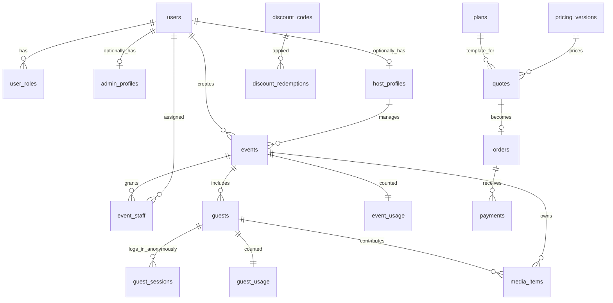

# D1 schema relationships and enforcement notes

## Identity and access



- `users` represent ordinary authenticated platform accounts. `user_roles` supports multiple roles per registered user. `admin_profiles` and `host_profiles` carry role-specific display/business data.
- `guests` represent **anonymous event participants**. They require a short name but not a registered account. One guest can have multiple active/revoked sessions. Session secrets are issued by the server and hashed in D1.
- `events` holds the fixed *purchased entitlement snapshot* of quotas and permissions; changing the product catalog must not silently change an existing event.
- `media_items` stores R2 object keys, size, status, duration, source (`camera` or `gallery`) and upload idempotency ID. No image/video bytes go into D1.
- `plans` and `pricing_versions` define server-side quote templates and calculations. `quotes`, `orders`, `payments` and `discount_redemptions` cover purchase and admin-managed offline payments.
- `event_usage`, `guest_usage`, `guest_delivery_daily`, `event_delivery_daily` are guardrails, not canonical vendor invoices. Provider billing should be reconciled separately.

## Atomic photo-slot reservation (conceptual API operation)

Run after authenticating a server-issued guest session and checking event status, guest capacity and capture window. Validate upload MIME/type/size. All client-supplied values are untrusted.

1. Create a new `client_upload_id` in the client, persist it across retries, and check whether `(guest_id, client_upload_id)` already exists.
2. In one D1 transaction/batch, atomically increment the requested media type's reserved count only **if** `uploaded + reserved < effective_guest_limit`. The effective limit is an event quota or a guest override.
3. In the same transaction/batch, conditionally reserve bytes in `event_usage` only if `used_storage_bytes + reserved_storage_bytes + new_bytes <= events.storage_quota_bytes`.
4. Insert one `media_items` record with `status='reserved'`, expiry and a unique per-guest client upload ID. If *any* operation fails, roll back the transaction. Authorize an R2 upload for a server-generated object key only after the reservation succeeds.
5. After the R2 object is successfully uploaded, verify its existence, type, size and duration as appropriate. In a transaction, change `reserved -> uploaded/ready`, decrement reserved counts and increment uploaded counts/bytes. This must be **idempotent**.
6. For abandoned/failed operations, reclaim reserved quotas only after confirming expiry and reconciling potential uploaded R2 objects. On delete, handle the object and counters with a retryable cleanup workflow.

**Example conditional guest photo reservation SQL:**

```sql
UPDATE guest_usage
SET photo_reserved = photo_reserved + 1,
    updated_at = unixepoch()
WHERE guest_id = ?
  AND photo_uploaded + photo_reserved < (
    SELECT COALESCE(g.photo_limit_override, e.photo_limit_per_guest)
    FROM guests AS g
    JOIN events AS e ON e.id = g.event_id
    WHERE g.id = guest_usage.guest_id AND g.status = 'active' AND e.status = 'live'
  )
RETURNING guest_id;
```

**Example event-byte reservation SQL:**

```sql
UPDATE event_usage
SET reserved_storage_bytes = reserved_storage_bytes + ?,
    updated_at = unixepoch()
WHERE event_id = ?
  AND used_storage_bytes + reserved_storage_bytes + ? <=
    (SELECT storage_quota_bytes FROM events WHERE id = event_usage.event_id)
RETURNING event_id;
```

Check that each query returns one row. Use D1's transaction-capable `batch` API to make reservations + insertions all-or-nothing; the engine enforces the SQL `WHERE` condition. For non-authoritative upload estimates, reserve the maximum accepted bytes and release the difference once the actual object is confirmed.

## Other required backend rules not solved by a schema alone

- Role checks: `user_roles` must be verified and cross-checked with `event_staff`, `events.owner_user_id`, guest sessions, etc. A FK proves *existence*, not **permission**.
- One human = one guest is **not provable** with name-only signup. Do not rely on IP uniqueness.
- Event guest capacity and anti-abuse need atomic enrollment and verification in the Worker.
- Strong limits on clip duration for **gallery uploads** require trusted server-side media inspection; client-provided duration is not proof.
- Parallel deletion/upload races, retry idempotency, multipart upload cleanup, daily usage counters and expiry must be tested with concurrent requests.
- If R2 private URLs are signed directly, authorization logs may represent **grants**, not exact bytes delivered. A player/download may reuse a grant until expiry; account for overshoot.
- Rate-limiting protects abuse; a financial hard cap requires more conservative admission rules and delivery/account reconciliation.
- When deleting media, do not cascade away D1 metadata without reliably deleting underlying R2 objects.
- Protect private data, set retention rules, use account-level logging policies, avoid storing IP addresses or session secrets unnecessarily and enforce data-deletion requests.

## Data retention and billing

Keep original photos and videos in R2 and retain media metadata until deletion is verified. `delete_media_after` and `cleanup_jobs` support event-by-event retention. Store payment proofs, if any, in private R2 keys. Never store complete payment credentials in D1. All amounts are integer paise; price snapshots remain immutable after a quote is accepted.

## Notes for schema review

- This migration is **foundational**, not a complete production release. It requires API authorization, schema evolution, secure R2 access and comprehensive tests.
- D1 Free permits up to 500 MB **per database**, with a 5 GB account-wide free storage quota as of October 2026; verify again before deployment.
- D1 foreign keys are enforced by default; migrations should not attempt to turn them off.
